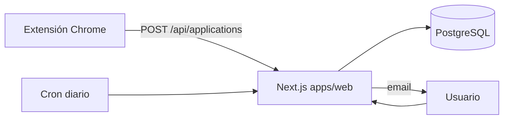

# jobtrail

> Todas tus candidaturas de empleo en un solo tablero. Guarda ofertas de LinkedIn, InfoJobs o Indeed con un clic y no vuelvas a olvidar un seguimiento.

[](https://github.com/gzlzz/jobtrail/actions/workflows/ci.yml)


**🔗 Demo en vivo:** _próximamente_ &nbsp;·&nbsp; 

<!-- Sustituir por un GIF de la app en cuanto exista: docs/demo.gif -->

## El problema
Cuando buscas trabajo acabas con decenas de candidaturas repartidas entre portales, emails y una hoja de cálculo que nadie actualiza. No sabes en qué fase está cada una, cuándo toca hacer seguimiento ni qué portal te da mejores resultados.

## La solución
- **Tablero Kanban** por fases: guardada → enviada → entrevista → oferta / rechazada.
- **Extensión de navegador**: guarda la oferta que estás viendo con un clic (empresa, puesto, URL, portal).
- **Recordatorios** de seguimiento por email si una candidatura lleva X días sin respuesta.
- **Estadísticas**: tasa de respuesta por portal y tiempo medio hasta la primera entrevista.
- **Exportar a CSV** tus datos cuando quieras.

## Stack
| Capa | Tecnología |
|------|------------|
| Frontend | Next.js 16 (App Router) · React 19 · Tailwind CSS 4 |
| Backend | Route Handlers / Server Actions de Next.js |
| Base de datos | PostgreSQL 17 · Prisma 7 |
| Extensión | Chrome Manifest V3 (TypeScript) |
| Infra / CI | npm workspaces · Docker Compose · GitHub Actions · Vercel + Neon |

## Arquitectura


```
jobtrail/
├── apps/
│   ├── web/          # Aplicación Next.js
│   └── extension/    # Extensión de navegador (semana 3)
└── packages/
    └── db/           # Esquema Prisma, migraciones y cliente compartido
```

## Ejecutar en local
Requisitos: Node 20+ y Docker (o una base de datos Postgres gratuita en [Neon](https://neon.tech)).

```bash
git clone https://github.com/gzlzz/jobtrail.git
cd jobtrail
cp .env.example .env
docker compose up -d
npm install
npm run db:migrate
npm run db:seed
npm run dev
```
Abre http://localhost:3000.

| Script | Qué hace |
|--------|----------|
| `npm run dev` | Arranca la app en modo desarrollo |
| `npm run build` | Genera el cliente Prisma y compila la app |
| `npm run lint` / `npm run typecheck` | Calidad de código (también en CI) |
| `npm run db:migrate` / `db:seed` / `db:studio` | Gestión de la base de datos |

## Decisiones técnicas
- **Monorepo con npm workspaces**: la app web y la extensión comparten el mismo esquema y tipos sin publicar paquetes.
- **Tabla `StatusEvent`**: en lugar de guardar solo la fase actual, se registra cada cambio. Así las estadísticas (tasa de respuesta, tiempos) salen de datos reales.
- _(Ir añadiendo aquí lo que fue difícil y cómo lo resolviste: es lo que te preguntarán en la entrevista.)_

## Roadmap
Ver [ROADMAP.md](ROADMAP.md).

## Autor
**Mario González** · [GitHub](https://github.com/gzlzz)
